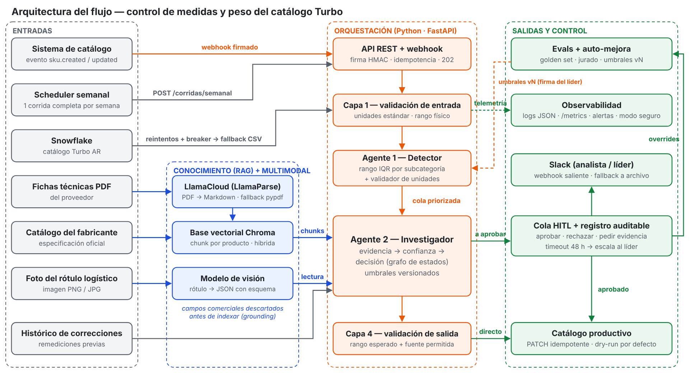
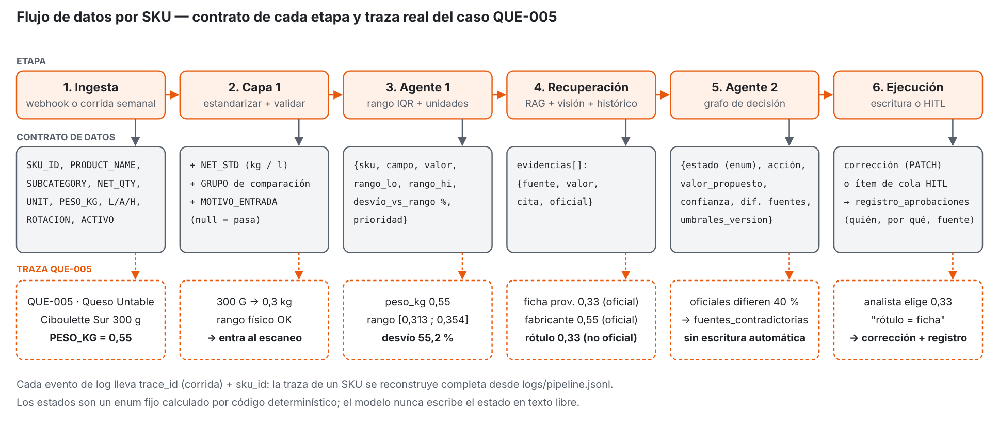
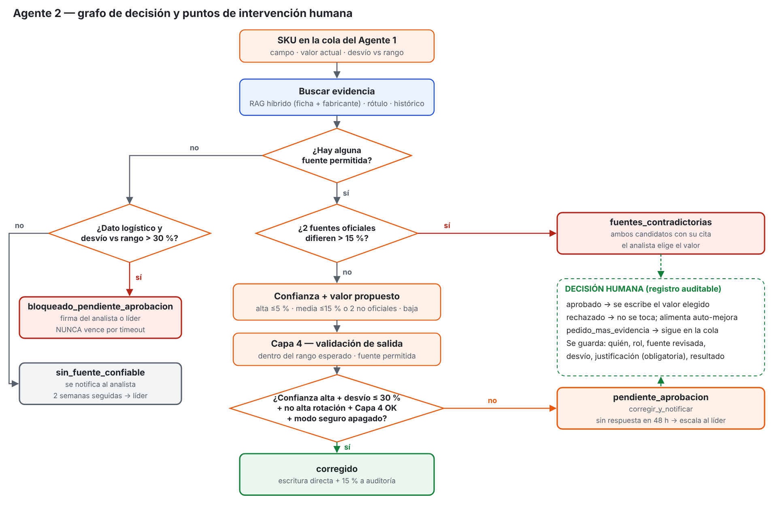
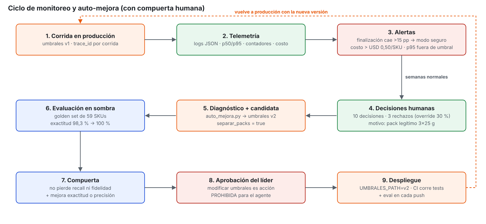
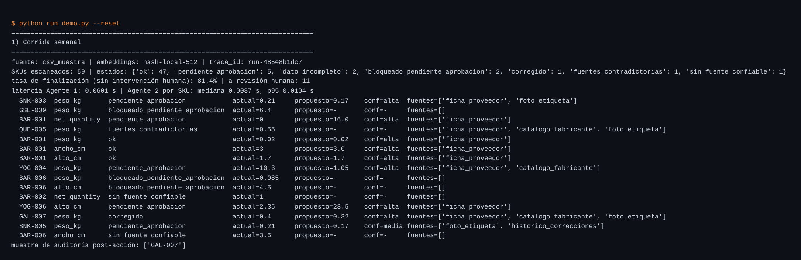
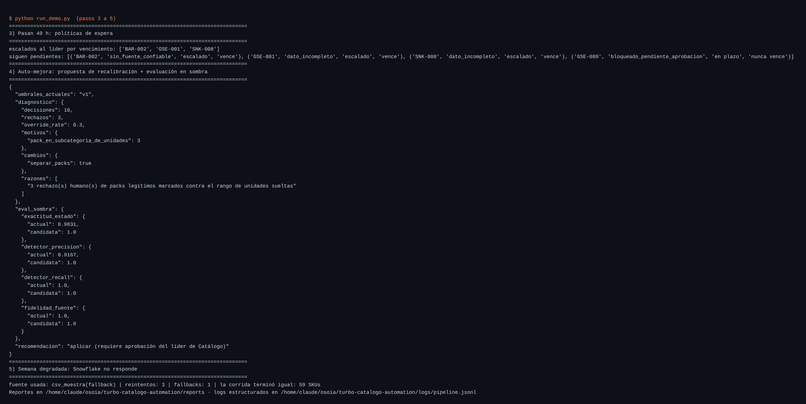
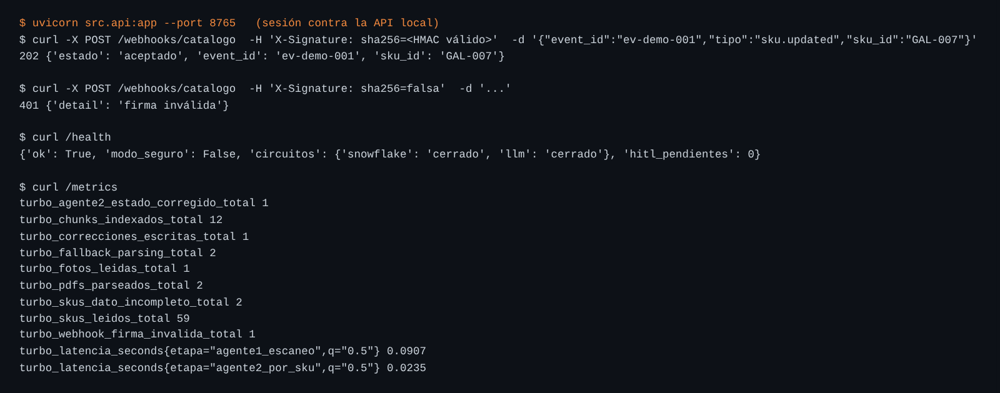
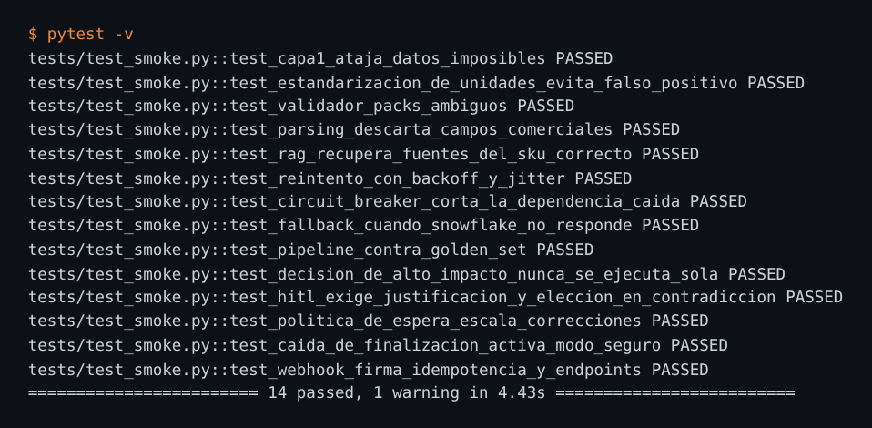
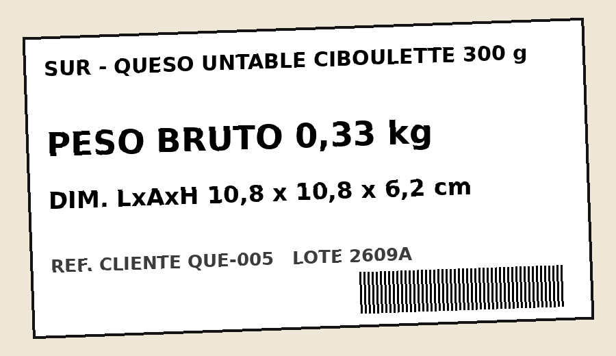

# Diagramas

## 1. Arquitectura

## 2. Flujo de datos por SKU (traza real de QUE-005)

## 3. Grafo de decisión del Agente 2 y puntos HITL

## 4. Ciclo de monitoreo y auto-mejora

## Capturas
- Corrida semanal: 
- Políticas de espera, auto-mejora y fallback de Snowflake: 
- API y webhook: 
- Smoke tests: 
- Input multimodal (rótulo de QUE-005): 
- Logs estructurados de ejemplo: [`ejemplo_logs.jsonl`](ejemplo_logs.jsonl)
